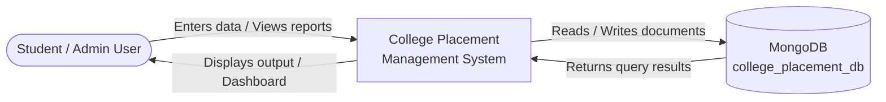
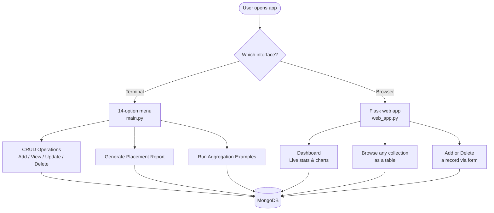
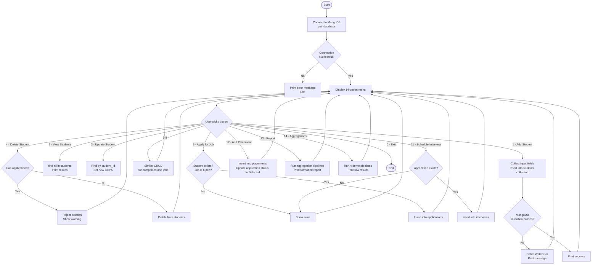
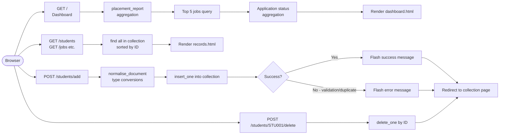

# College Placement Management System
### Project Report — CA-2 Assignment
**Subject:** NoSQL Database Management Systems
**Database Used:** MongoDB

---

## Table of Contents

1. [Introduction](#1-introduction)
   - 1.1 Background
   - 1.2 Problem Statement
   - 1.3 Objectives
   - 1.4 Scope
2. [Methods](#2-methods)
   - 2.1 Development Approach
   - 2.2 Database Design Strategy
   - 2.3 Why MongoDB?
3. [Software Requirements](#3-software-requirements)
   - 3.1 Hardware Requirements
   - 3.2 Software Requirements
   - 3.3 Python Packages Used
4. [Design](#4-design)
   - 4.1 System Architecture
   - 4.2 Database Schema & Collections
   - 4.3 Data Flow Diagram
   - 4.4 Application Flowchart
   - 4.5 Web Dashboard UI Overview
5. [Implementation](#5-implementation)
   - 5.1 Project Structure
   - 5.2 Database Setup
   - 5.3 Schema Validation
   - 5.4 CRUD Operations
   - 5.5 Aggregation Pipelines
   - 5.6 Web Application
   - 5.7 Terminal Application
   - 5.8 Testing
6. [Conclusion](#6-conclusion)

---

## 1. Introduction

### 1.1 Background

Every college has a placement cell — a department that coordinates between final-year students and recruiting companies. The cell keeps track of which companies are coming, what jobs they're offering, which students are eligible, who applied, who cleared the interview rounds, and who finally got an offer letter. Historically this has been managed using Excel sheets or simple spreadsheets which works when the numbers are small but breaks down as the data grows.

This project is an attempt to build a proper software system for that exact purpose — a College Placement Management System backed by a MongoDB database. It was developed as part of the CA-2 assignment for the NoSQL Database Management Systems course.

### 1.2 Problem Statement

Managing campus placement data through spreadsheets or traditional SQL systems comes with real limitations. Data gets duplicated — the same company name shows up in a hundred rows. Updates are error-prone — you change something in one place and forget to change it in ten other rows. Relationships between entities like students, their applications, interview results, and final offers are hard to represent cleanly in a flat table structure.

The core problem is that placement data is naturally **relational but flexible** — a student can apply to many jobs, a company can post multiple openings, and each application goes through its own interview journey. A rigid fixed-schema relational database can handle this, but it requires a lot of upfront table design and JOIN-heavy queries. MongoDB offers a more natural fit here — documents can hold embedded arrays, the schema can be enforced selectively, and aggregation pipelines make analytics straightforward.

### 1.3 Objectives

The main goals of this project were:

- Design a MongoDB database with **six interrelated collections** that represent the full campus recruitment lifecycle
- Implement **strict schema validation** using MongoDB's `$jsonSchema` validator so bad data never enters the system
- Build **Create, Read, Update, and Delete (CRUD)** operations through both a Python terminal application and a web dashboard
- Write **aggregation pipelines** to extract meaningful analytics — average salary, top hiring company, placement counts by department, etc.
- Provide a **live web dashboard** built with Flask that shows all statistics in real time
- Keep the code clean, modular, and properly commented so it's actually readable

### 1.4 Scope

This project covers the following entities in the campus placement process:
- Students (their profile, department, CGPA, skills)
- Companies (the recruiters visiting campus)
- Jobs (the specific roles and packages each company is offering)
- Applications (which student applied to which job)
- Interviews (the rounds conducted for each application)
- Placements (the final confirmed offers)

It does **not** cover things like email notifications, student login/authentication, or bulk imports from Excel — those would be useful in a production system but are outside the scope of this assignment.

---

## 2. Methods

### 2.1 Development Approach

The project was built incrementally. The database layer was set up first — collections, validation rules, indexes, and sample data. Once the database was working and verified, the terminal application was built on top. Finally, the web interface was added as a more polished way to interact with the same database.

The overall approach followed these steps:
1. Identify the entities and how they relate to each other
2. Design the MongoDB collections and decide what to embed vs. what to reference
3. Write schema validators for each collection
4. Create realistic sample data for demonstrations
5. Build the terminal menu application
6. Build the Flask web dashboard
7. Write standalone mongosh scripts for assignment evidence
8. Write a smoke test to verify everything works end to end

### 2.2 Database Design Strategy

The most important design decision was figuring out what goes into its own collection versus what gets embedded inside another document.

**Separate collections** were used for Students, Companies, Jobs, Applications, Interviews, and Placements. The reasoning is straightforward — each of these entities has its own lifecycle. A company's name or location might change. A student's CGPA gets updated. A job's status flips from Open to Closed. If these were embedded inside each other, a single company name change would require updating dozens of documents. By keeping them separate and referencing by ID, one update is enough.

**Embedded arrays** were used for skills. A student's skills list lives inside the student document, not in a separate collection. The same for job requirements — `skills_required` is an array inside the job document. This makes sense because skills are always queried together with the student or job they belong to. There's no case where you'd need to query skills independently of their parent document.

This approach — separating entities that change independently and embedding data that always travels together — is a standard MongoDB design pattern.

### 2.3 Why MongoDB?

MongoDB was chosen for this project for a few specific reasons:

**Flexible document structure:** A student document can have a `skills` array with zero entries or twenty entries. You don't need to pre-define how many skills a student will have — the document just holds however many there are.

**Schema validation where needed:** One common criticism of NoSQL databases is "you can put anything in." MongoDB's `$jsonSchema` validator addresses this — you can define strict rules (CGPA must be between 0 and 10, status must be one of a fixed set of values) and MongoDB will reject any document that doesn't comply. This project makes heavy use of this feature.

**Aggregation framework:** MongoDB's aggregation pipelines are powerful enough to do grouping, averaging, sorting, limiting, and joining across collections — all in a single query. The placement report on the dashboard is generated entirely through aggregation pipelines with no post-processing in Python.

**`$lookup` for joins:** While MongoDB isn't a relational database, `$lookup` lets you join documents from two collections on a matching field — similar to a SQL JOIN. This was used extensively to enrich application records with student and job information.

---

## 3. Software Requirements

### 3.1 Hardware Requirements

| Component | Minimum |
|-----------|---------|
| Processor | Intel Core i3 or equivalent (any modern processor works) |
| RAM | 4 GB (MongoDB recommends at least 2 GB available) |
| Storage | 1 GB free space (for MongoDB data files and the project) |
| OS | Windows 10/11, macOS, or Linux |

### 3.2 Software Requirements

| Software | Version | Purpose |
|----------|---------|---------|
| Python | 3.10 or later | Core programming language |
| MongoDB Community Server | 6.0 or later | Database engine |
| MongoDB Shell (mongosh) | 2.0 or later | Running `.js` query scripts from terminal |
| MongoDB Compass (optional) | Any recent version | GUI to visually inspect the database |
| A web browser | Any modern browser | Viewing the Flask web dashboard |
| pip | Latest | Installing Python packages |

### 3.3 Python Packages Used

These are listed in [`requirements.txt`](file:///d:/Nosql/College%20Placement%20Management%20System/requirements.txt):

| Package | Version Range | What It Does |
|---------|---------------|-------------|
| `pymongo` | >=4.6, <5 | The official MongoDB driver for Python. Handles all communication between Python code and the MongoDB server — inserting documents, querying, running aggregations, managing indexes, etc. |
| `python-dotenv` | >=1.0, <2 | Reads the `.env` configuration file and loads it into environment variables. This keeps the MongoDB connection string out of the code itself, which is good practice. |
| `Flask` | >=3.0, <4 | A lightweight Python web framework. Handles HTTP routes, renders HTML templates, processes form submissions, and manages flash messages (success/error notifications). Jinja2 (Flask's built-in templating engine) is also used through Flask. |

**Installation command:**
```powershell
pip install -r requirements.txt
```

---

## 4. Design

### 4.1 System Architecture

The system is split into three layers:

```
┌─────────────────────────────────────────────────────────┐
│                   PRESENTATION LAYER                    │
│                                                         │
│   main.py (Terminal Menu)    web_app.py (Flask/Browser) │
│   14-option interactive      Dashboard + Collection      │
│   menu for all CRUD ops      pages at localhost:5000     │
└────────────────────┬────────────────────────────────────┘
                     │  Python function calls
┌────────────────────▼────────────────────────────────────┐
│                    LOGIC LAYER                          │
│                                                         │
│   operations/reports.py     database/validation.py      │
│   Aggregation pipelines      Schema rules & indexes      │
│   Placement report           database/sample_data.py    │
│   Analytics functions        Demo data seeding          │
└────────────────────┬────────────────────────────────────┘
                     │  PyMongo (BSON over TCP)
┌────────────────────▼────────────────────────────────────┐
│                   DATABASE LAYER                        │
│                                                         │
│   MongoDB — college_placement_db                        │
│                                                         │
│   students  companies  jobs  applications               │
│   interviews  placements                                │
└─────────────────────────────────────────────────────────┘
```

### 4.2 Database Schema & Collections

The database has six collections. Below is what each one stores and how they link to each other.

---

**Collection 1: `students`**

Stores the profile of each student eligible for placement.

| Field | Type | Constraints |
|-------|------|-------------|
| student_id | String | Required, Unique |
| name | String | Required, min length 2 |
| email | String | Required, Unique, must match email pattern |
| phone | String | Optional |
| department | String | Required |
| year | Integer | Required, between 1 and 4 |
| cgpa | Number | Required, between 0 and 10 |
| skills | Array of Strings | Embedded — e.g. `["Python", "MongoDB"]` |

---

**Collection 2: `companies`**

Stores the recruiting companies visiting campus.

| Field | Type | Constraints |
|-------|------|-------------|
| company_id | String | Required, Unique |
| name | String | Required |
| industry | String | Required |
| location | String | Required |
| website | String | Optional |

---

**Collection 3: `jobs`**

Stores the specific job openings each company is offering.

| Field | Type | Constraints |
|-------|------|-------------|
| job_id | String | Required, Unique |
| company_id | String | Required — references `companies` |
| title | String | Required |
| package_lpa | Number | Required, minimum 0 |
| location | String | Optional |
| skills_required | Array | Embedded — skills needed for the role |
| vacancies | Integer | Required, minimum 0 |
| status | String | Required — only `"Open"` or `"Closed"` |

---

**Collection 4: `applications`**

Tracks which student applied to which job, and the current status.

| Field | Type | Constraints |
|-------|------|-------------|
| application_id | String | Required, Unique |
| student_id | String | Required — references `students` |
| job_id | String | Required — references `jobs` |
| application_date | Date | Required |
| status | String | Required — only `"Applied"`, `"Shortlisted"`, `"Rejected"`, `"Selected"` |

---

**Collection 5: `interviews`**

Tracks interview rounds for each application.

| Field | Type | Constraints |
|-------|------|-------------|
| interview_id | String | Required, Unique |
| application_id | String | Required — references `applications` |
| round | String | Required — e.g. "Technical", "HR" |
| interview_date | Date | Required |
| result | String | Required — only `"Scheduled"`, `"Passed"`, `"Failed"` |

---

**Collection 6: `placements`**

The final record of a confirmed placement offer.

| Field | Type | Constraints |
|-------|------|-------------|
| placement_id | String | Required, Unique |
| student_id | String | Required — references `students` |
| company_id | String | Required — references `companies` |
| job_id | String | Required — references `jobs` |
| package_lpa | Number | Required, minimum 0 |
| placement_date | Date | Required |
| status | String | Required — only `"Placed"` |

---

**Relationships at a glance:**

```
companies (company_id)
    └──→ jobs (company_id → companies.company_id)
              └──→ applications (job_id → jobs.job_id)
                        └──→ interviews (application_id → applications.application_id)

students (student_id)
    └──→ applications (student_id → students.student_id)
    └──→ placements (student_id → students.student_id)

jobs (job_id)
    └──→ placements (job_id → jobs.job_id)
```

### 4.3 Data Flow Diagram

**Level 0 — Context Diagram (Overall System)**



---

**Level 1 — Main Processes**



### 4.4 Application Flowchart

**Terminal Application Flow (`main.py`)**



**Web Application Request Flow (`web_app.py`)**



### 4.5 Web Dashboard UI Overview

The web dashboard (named **PlaceFlow** internally) has a two-panel layout:

**Sidebar (left, always visible):**
- Brand logo — "P PlaceFlow"
- "WORKSPACE" label
- Navigation links: Overview, Students, Companies, Jobs, Applications, Interviews, Placements
- Footer — "MongoDB · PyMongo / CA-2 Placement System"

**Main Content Area (right):**

The header always shows the page title and a "LIVE DATA — MongoDB connected" indicator in the top right corner.

**Dashboard page (`/`):**
- Hero banner — a gradient blue card with the text "2026 Placement Cycle / Make every opportunity count" and a "Manage students →" button
- 9 metric cards in a responsive grid — Total Students, Total Companies, Total Jobs, Total Applications, Total Selected, Average Package, Highest Package, Top Hiring Company, Most Applied Job
- A "Top paying roles" table — top 5 jobs with title, location, package, and status shown as a teal badge
- An "Application pipeline" panel — horizontal progress bars for each application status (Applied, Shortlisted, Rejected, Selected) showing counts and proportions

**Collection pages (`/students`, `/jobs`, etc.):**
- An intro bar with the collection name and "+ Add [entity]" button
- A scrollable table of all records in that collection, with a "Delete" button on each row
- Below the table — an "Add New Record" form with auto-generated input fields appropriate for that collection

**Design choices:**
- Dark navy sidebar (`#14213d`) with teal accent (`#299d8f`) gives it a professional look
- `DM Sans` for body text and `Playfair Display` for headings (both from Google Fonts)
- Fully responsive — on small screens the sidebar collapses to a horizontal scroll nav
- Flash messages appear at the top of the content area in green (success) or red (error)

---

## 5. Implementation

### 5.1 Project Structure

```
College Placement Management System/
│
├── .env.example          ← Template for environment config
├── requirements.txt      ← Python package dependencies
├── setup_database.py     ← Run once: creates schema + loads sample data
├── main.py               ← Terminal menu application
├── web_app.py            ← Flask web dashboard
│
├── database/
│   ├── __init__.py
│   ├── connection.py     ← MongoDB connection handler
│   ├── validation.py     ← $jsonSchema validators + index definitions
│   └── sample_data.py    ← Realistic demo data + seed function
│
├── operations/
│   ├── __init__.py
│   └── reports.py        ← Aggregation pipelines for analytics
│
├── queries/
│   ├── setup_database.js ← mongosh version of setup (for assignment demo)
│   ├── crud_queries.js   ← CRUD examples in mongosh syntax
│   └── aggregation_queries.js ← Aggregation examples in mongosh
│
├── templates/
│   ├── base.html         ← Shared layout (sidebar + header)
│   ├── dashboard.html    ← Home page with stats and charts
│   └── records.html      ← Generic collection table + add form
│
├── static/
│   └── styles.css        ← All CSS for the web dashboard
│
└── tests/
    └── mongosh_smoke_test.js ← Verifies setup is correct
```

### 5.2 Database Setup

The [`setup_database.py`](file:///d:/Nosql/College%20Placement%20Management%20System/setup_database.py) script is the entry point for initialising everything. It does three things in sequence:

```python
db = get_database()    # 1. Connect to MongoDB
create_schema(db)      # 2. Create collections with validators + indexes
seed_database(db)      # 3. Insert sample data (upsert-safe)
```

The connection function in [`database/connection.py`](file:///d:/Nosql/College%20Placement%20Management%20System/database/connection.py) reads the MongoDB URI from the `.env` file and pings the server before returning the database handle. If MongoDB isn't running, it throws a clear `RuntimeError` with a helpful message instead of crashing silently.

```python
def get_database():
    uri = os.getenv("MONGODB_URI", "mongodb://localhost:27017/")
    database_name = os.getenv("MONGODB_DB", "college_placement_db")
    client = MongoClient(uri, serverSelectionTimeoutMS=4000)
    try:
        client.admin.command("ping")
    except ServerSelectionTimeoutError as error:
        raise RuntimeError(
            "MongoDB is not reachable. Start MongoDB, then check MONGODB_URI in .env."
        ) from error
    return client[database_name]
```

### 5.3 Schema Validation

[`database/validation.py`](file:///d:/Nosql/College%20Placement%20Management%20System/database/validation.py) defines `$jsonSchema` validators for all six collections. The validators are applied using `validationLevel: "strict"` and `validationAction: "error"` — meaning any document that doesn't comply is flatly rejected with an error, it is not silently accepted.

A sample validator for the students collection:

```python
"students": {
    "$jsonSchema": {
        "bsonType": "object",
        "required": ["student_id", "name", "email", "department", "year", "cgpa"],
        "properties": {
            "year":  {"bsonType": "int",    "minimum": 1, "maximum": 4},
            "cgpa":  {"bsonType": ["double","int","decimal"], "minimum": 0, "maximum": 10},
            "email": {"bsonType": "string", "pattern": "^.+@.+\\..+$"},
            "skills":{"bsonType": "array",  "items": {"bsonType": "string"}},
        },
    }
}
```

This means:
- You cannot insert a student without their ID, name, email, department, year, and CGPA
- CGPA must be between 0 and 10 — CGPA of 11 is rejected at the database level
- Email must match a basic email pattern
- Skills must be an array of strings, not a comma-separated string accidentally passed as text

After applying validators, unique indexes are created:

```python
for field in UNIQUE_INDEXES[name]:
    db[name].create_index(field, unique=True)
```

A compound index on `(status, package_lpa)` on jobs speeds up queries like "show me all open jobs sorted by salary" — this is a very common query in the app so indexing makes sense.

### 5.4 CRUD Operations

All four database operations are implemented in [`main.py`](file:///d:/Nosql/College%20Placement%20Management%20System/main.py).

**Create — adding a student:**
```python
def add_student(db):
    document = {
        "student_id": input("Student ID: ").strip(),
        "name":       input("Name: ").strip(),
        "cgpa":       float(input("CGPA (0-10): ")),
        "skills":     [s.strip() for s in input("Skills (comma-separated): ").split(",") if s.strip()],
        # ... other fields
    }
    db.students.insert_one(document)
```

**Read — viewing students:**
```python
show_documents(db.students.find())
```

**Update — changing a student's CGPA:**
```python
def update_student(db):
    student_id = input("Student ID: ").strip()
    cgpa = float(input("New CGPA (0-10): "))
    result = db.students.update_one(
        {"student_id": student_id},
        {"$set": {"cgpa": cgpa}}
    )
```

**Delete — with a safety check:**
```python
def delete_student(db):
    student_id = input("Student ID: ").strip()
    if db.applications.count_documents({"student_id": student_id}):
        print("Cannot delete: this student has job applications.")
        return
    result = db.students.delete_one({"student_id": student_id})
```

The delete function first checks whether the student has any applications. If they do, the deletion is blocked. This prevents orphaned application records from pointing to a non-existent student.

**Placement recording** also updates related records automatically:
```python
db.placements.insert_one({...})
db.applications.update_many(
    {"student_id": student_id, "job_id": job_id},
    {"$set": {"status": "Selected"}}
)
```

When a placement is confirmed, all matching applications for that student-job combination are updated to "Selected" status in a single `update_many` call.

### 5.5 Aggregation Pipelines

The [`operations/reports.py`](file:///d:/Nosql/College%20Placement%20Management%20System/operations/reports.py) file contains the analytics logic. Every number on the dashboard is calculated live by a MongoDB aggregation, not hardcoded or cached.

**Example 1 — Average package across all jobs:**
```python
average = list(db.jobs.aggregate([
    {"$group": {"_id": None, "average": {"$avg": "$package_lpa"}}}
]))
```

**Example 2 — Top hiring company (with `$lookup`):**
```python
hiring_company = list(db.placements.aggregate([
    {"$group": {"_id": "$company_id", "placements": {"$sum": 1}}},
    {"$sort": {"placements": -1}},
    {"$limit": 1},
    {"$lookup": {
        "from": "companies",
        "localField": "_id",
        "foreignField": "company_id",
        "as": "company"
    }},
    {"$unwind": "$company"},
    {"$project": {"_id": 0, "name": "$company.name", "placements": 1}},
]))
```

This pipeline:
1. Groups all placements by company and counts them
2. Sorts to get the company with the most placements first
3. Limits to just that top result
4. Joins with the companies collection to get the actual company name
5. Flattens the resulting array and projects only the fields we need

**Example 3 — Applications enriched with student info:**
```python
[
    {"$lookup": {
        "from": "students", "localField": "student_id",
        "foreignField": "student_id", "as": "student"
    }},
    {"$unwind": "$student"},
    {"$project": {
        "_id": 0, "application_id": 1, "status": 1,
        "student.name": 1, "student.department": 1, "student.cgpa": 1
    }},
]
```

This is essentially the same as a SQL `JOIN` between `applications` and `students` on `student_id`.

The four aggregation examples shown by menu option 14:
- Applications grouped by status
- Students grouped by department
- Top 5 jobs sorted by package
- Applications with full student details (the `$lookup` join)

### 5.6 Web Application

[`web_app.py`](file:///d:/Nosql/College%20Placement%20Management%20System/web_app.py) is a Flask application with four URL routes.

The `COLLECTIONS` dictionary is the heart of the web app. It defines the fields, labels, and input types for all six collections in one place:

```python
COLLECTIONS = {
    "students": {
        "label": "Students",
        "id": "student_id",
        "fields": [
            ("student_id", "Student ID",   "text"),
            ("name",       "Full name",     "text"),
            ("email",      "Email",         "email"),
            ("cgpa",       "CGPA",          "number"),
            ("skills",     "Skills (comma separated)", "text"),
            # ...
        ]
    },
    # ... five more collections
}
```

Because of this config, a single `records.html` template handles all six collection pages — it reads the field list and generates table columns and form inputs automatically. This avoids writing six almost-identical HTML pages.

The `normalise_document()` function converts raw form string inputs into the right Python types before inserting into MongoDB:

```python
def normalise_document(collection, form):
    document = {key: form.get(key, "").strip() for key, _, _ in COLLECTIONS[collection]["fields"]}
    for key in ("year", "vacancies"):
        if key in document: document[key] = int(document[key])
    for key in ("cgpa", "package_lpa"):
        if key in document: document[key] = float(document[key])
    for key in ("skills", "skills_required"):
        if key in document: document[key] = [i.strip() for i in document[key].split(",") if i.strip()]
    for key in ("application_date", "interview_date", "placement_date"):
        if key in document: document[key] = datetime.strptime(document[key], "%Y-%m-%d")
    return document
```

Without this, everything from an HTML form arrives as a plain string — `"4"` instead of integer `4`, `"Python, MongoDB"` instead of `["Python", "MongoDB"]`. The normaliser fixes all of that before the data touches MongoDB.

Flask's flash messaging is used for feedback:
```python
flash("Record added successfully.", "success")
flash(f"Could not save record: {error}", "error")
```

These appear at the top of the next page load, styled as green or red banners.

### 5.7 Terminal Application

The terminal application in [`main.py`](file:///d:/Nosql/College%20Placement%20Management%20System/main.py) uses a simple dictionary-based dispatch pattern instead of a long `if/elif` chain:

```python
actions = {
    "1": lambda: add_student(db),
    "2": lambda: show_documents(db.students.find()),
    "3": lambda: update_student(db),
    # ...
}
while True:
    print(MENU)
    choice = input("Choose an option: ").strip()
    if choice == "0":
        return
    action = actions.get(choice)
    if action:
        action()
```

All actions are wrapped in a try-except that catches:
- `ValueError` — user typed letters where a number was expected
- `DuplicateKeyError` — tried to insert a record with a student_id or email that already exists
- `WriteError` — MongoDB rejected the document because it failed schema validation

This means a bad input never crashes the application — it prints an error and loops back to the menu.

### 5.8 Testing

[`tests/mongosh_smoke_test.js`](file:///d:/Nosql/College%20Placement%20Management%20System/tests/mongosh_smoke_test.js) runs three verification checks:

**Test 1 — Collection count check:**
```javascript
const expectedCounts = {
    students: 5, companies: 3, jobs: 4,
    applications: 5, interviews: 4, placements: 2
};
for (const [collection, expected] of Object.entries(expectedCounts)) {
    const actual = placementDb[collection].countDocuments();
    if (actual < expected)
        throw new Error(`${collection}: expected at least ${expected}, got ${actual}`);
}
```

**Test 2 — `$lookup` integrity check:**
```javascript
const lookupRows = placementDb.applications.aggregate([
    { $lookup: { from: "students", localField: "student_id",
                 foreignField: "student_id", as: "student" } },
    { $unwind: "$student" },
    { $project: { _id: 0, application_id: 1, "student.name": 1 } }
]).toArray();
if (lookupRows.length !== placementDb.applications.countDocuments())
    throw new Error("$lookup did not match every application to a student.");
```

**Test 3 — Validation enforcement check:**
```javascript
let validationRejected = false;
try {
    placementDb.students.insertOne({
        student_id: "INVALID_CGPA", name: "Invalid Test",
        email: "invalid@example.edu", department: "CSE",
        year: NumberInt(4), cgpa: 11   // INVALID — max is 10
    });
} catch (error) {
    validationRejected = true;
}
if (!validationRejected)
    throw new Error("Invalid CGPA was accepted — validation is broken.");
```

If all three pass, the script prints:
```json
{ "result": "PASS", "collections": {...}, "lookup_rows": 5, "validation": "invalid CGPA rejected" }
```

---

## 6. Conclusion

The College Placement Management System successfully demonstrates a well-structured MongoDB application covering the complete campus recruitment lifecycle. The six-collection design keeps data clean and avoids duplication — updating a company's name or a job's status requires exactly one database write, not many.

Schema validation at the database level (not just in application code) proved to be one of the more useful decisions. It means even direct database access — whether through the Python app, the web dashboard, or manual mongosh commands — cannot introduce invalid records. The CGPA validator test in the smoke test file proves this is actually working, not just assumed.

The `$lookup` aggregation pipeline is arguably the most important MongoDB feature demonstrated here — it bridges the gap between document and relational thinking, allowing the dashboard to display enriched data (applications with student names, placements with company names) without duplicating that information across collections.

The dual interface approach (terminal menu + web dashboard) was practical for the assignment — the terminal application shows all the CRUD logic clearly in code, while the web dashboard provides a more realistic demonstration of what such a system would look like in use.

If this were to be extended further, the obvious next steps would be adding authentication (a placement officer login), email notifications when interview results are updated, and a bulk import feature for loading large batches of student records from a CSV file.

---

*Report prepared for CA-2 NoSQL Database Management Systems Assignment.*
*Database: MongoDB | Language: Python 3.10+ | Framework: Flask 3.x*
